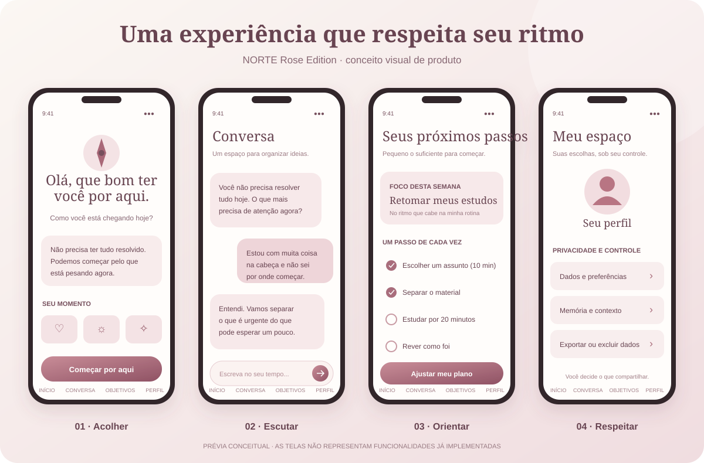

<p align="center">
  
</p>

<h1 align="center">NORTE</h1>

<p align="center">
  <strong>Seu tempo. Sua história. Seu caminho.</strong>
</p>

<p align="center">
  Uma plataforma de orientação pessoal com inteligência artificial para ajudar pessoas a compreender o momento que vivem, encontrar clareza e transformar possibilidades em próximos passos realistas.
</p>

<p align="center">
  
  
  
  
  
  
</p>

---

## Antes de qualquer plano, existe uma pessoa.

Nem sempre falta capacidade, vontade ou disciplina para mudar. Às vezes, a pessoa está cansada. Tem responsabilidades demais, não sabe por onde começar ou já tentou seguir planos que não cabiam na sua realidade.

Ela não precisa necessariamente de mais uma lista de cobranças. Pode precisar de um espaço para organizar o que está acontecendo, reconhecer o que é possível agora e dar um primeiro passo sem se sentir julgada.

O **NORTE** nasce dessa ideia.

Queremos construir uma tecnologia que ajude pessoas a encontrar clareza e direção sem ignorar aquilo que as torna humanas: seus limites, sentimentos, responsabilidades, histórias e possibilidades.

<p align="center">
  
</p>

> **Acreditamos que um caminho só faz sentido quando considera a pessoa que precisa percorrê-lo.**

## Como imaginamos essa experiência

O NORTE não deve tratar todo mundo como alguém que só precisa produzir mais. Uma pessoa pode chegar querendo mudar de carreira, reorganizar a rotina, recuperar a confiança para começar, lidar com muitas responsabilidades ou simplesmente entender o que está acontecendo.

A experiência que estamos construindo procura seguir quatro movimentos:

1. **Acolher:** receber a pessoa sem julgamento e entender como ela está chegando.
2. **Escutar:** conhecer seu contexto antes de oferecer respostas prontas.
3. **Orientar:** transformar o que foi compreendido em possibilidades e próximos passos.
4. **Respeitar:** adaptar o caminho ao tempo, à energia e às circunstâncias de cada pessoa.

<p align="center">
  
</p>

<p align="center">
  <em>Prévia conceitual da experiência mobile — não representa funcionalidades já implementadas.</em>
</p>

### O que essas telas representam

| Experiência | O que queremos transmitir |
|---|---|
| **Início** | Um primeiro contato acolhedor, sem pressão para resolver tudo de uma vez. |
| **Conversa** | Um espaço para organizar pensamentos e compreender prioridades. |
| **Objetivos** | Pequenos passos que façam sentido na rotina real da pessoa. |
| **Meu espaço** | Clareza e controle sobre perfil, preferências e dados pessoais. |

**Transparência:** as imagens acima são conceitos visuais criados para comunicar a direção do produto. O aplicativo Flutter já possui um protótipo navegável, mas as telas conceituais não são capturas de funcionalidades prontas. A conversa ainda não utiliza IA, os dados demonstrativos não são persistidos e o cliente ainda não está integrado à API.

## O problema que queremos ajudar a resolver

- **Falta de direção:** objetivos importantes parecem grandes demais para começar.
- **Sobrecarga:** responsabilidades e imprevistos dificultam transformar intenção em ação.
- **Orientação genérica:** conselhos que ignoram contexto, limitações e prioridades reais tendem a não funcionar.
- **Planos rígidos:** a vida muda, mas muitos planejamentos não mudam com ela.
- **Dificuldade de recomeçar:** uma interrupção pode virar culpa, desânimo e abandono.

O NORTE pretende apoiar um processo contínuo: compreender, organizar, escolher uma prioridade, agir e revisar o caminho. Não promete resolver a vida de ninguém nem substitui acompanhamento profissional quando ele é necessário.

## Identidade visual — Rose Edition

A direção visual oficial é delicada, acolhedora e sofisticada, sem infantilizar a experiência ou restringi-la a um único público.

### Paleta

| Cor | Código | Uso previsto |
|---|---|---|
| Rose | `#B87583` | Identidade e destaques |
| Blush | `#F3DDDF` | Superfícies e realces suaves |
| Creme | `#F9F4EF` | Fundo principal |
| Nude | `#E9DCD3` | Cartões e áreas de apoio |
| Vinho suave | `#76505D` | Textos e elementos de contraste |
| Champagne | `#D7C4B8` | Bordas e detalhes |
| Verde suave | `#638875` | Estados positivos |
| Âmbar | `#C18B52` | Atenção e alertas |

### Direção de interface

- **Tipografia planejada:** Fraunces para títulos e DM Sans para interface e leitura.
- **Componentes:** cartões com cantos suaves, hierarquia clara e espaços generosos.
- **Ícones:** traços leves e consistentes.
- **Movimento:** animações discretas e funcionais.
- **Acessibilidade:** contraste, legibilidade e responsividade devem prevalecer sobre escolhas puramente estéticas.

## Visão de produto

A experiência completa está sendo construída em etapas:

1. **Compreensão:** conversa para conhecer contexto, desafios e prioridades.
2. **Clareza:** síntese do cenário, sujeita à confirmação da pessoa.
3. **Direção:** objetivos e próximos passos compatíveis com a realidade apresentada.
4. **Ação:** plano curto, tarefas e lembretes para facilitar o começo.
5. **Adaptação:** revisão do progresso e ajuste do plano quando as circunstâncias mudarem.

Esses itens representam a visão do produto, não funcionalidades já concluídas.

## Escopo do MVP

O primeiro produto validável está concentrado em:

- Cadastro, autenticação e gestão da conta.
- Conversa com IA por texto.
- Resumo do contexto, confirmável pelo usuário.
- Perfil progressivo e memória básica sob controle do usuário.
- Objetivos, plano de 7 dias, tarefas e lembretes.
- Revisão do progresso e adaptação do plano.
- Limites de uso e controle de custos da IA.

O piloto inicial será direcionado a pessoas no Brasil que desejam entrar ou migrar para a área de tecnologia. Esse recorte reduz o escopo da validação sem limitar a visão futura do NORTE.

### Fora do MVP inicial

Voz, aplicativo web em Next.js, pagamentos, gestão financeira, comunidade, gamificação e integrações externas ficam para etapas posteriores.

---

## Estado atual do desenvolvimento

O repositório contém a fundação do backend e a primeira versão navegável do cliente Flutter. A integração entre as duas partes ainda está pendente.

### Backend — disponível

- API REST com Spring Boot.
- Cadastro e login com autenticação baseada em JWT.
- Consulta do perfil associado ao token autenticado.
- Persistência com Spring Data JPA, PostgreSQL e Flyway.
- Endpoint de status e health check com Spring Boot Actuator.
- Validação de dados e testes automatizados.

### Flutter — protótipo navegável

- Tela de entrada e criação de conta demonstrativas.
- Visão inicial com check-in de estado e foco atual.
- Tela de conversa com envio local de mensagens, sem IA conectada.
- Objetivos e tarefas de demonstração com marcação local.
- Área de perfil com opções ilustrativas de privacidade e gestão de dados.
- Primeira aplicação da identidade Rose Edition.

### Próximas entregas planejadas

1. Refinar estrutura, acessibilidade e responsividade do Flutter.
2. Evoluir autenticação com refresh token, logout e proteção contra tentativas excessivas.
3. Implementar perfil progressivo, objetivos e tarefas na API.
4. Criar o AI Gateway, conversa orientada e plano de ação com limites de custo.
5. Integrar o aplicativo à API com tratamento seguro de sessão, erros e carregamento.
6. Executar testes de autorização, isolamento e privacidade antes de qualquer piloto.

Consulte [docs/MVP-ESCOPO.md](docs/MVP-ESCOPO.md) para ver o recorte funcional e a ordem de construção.

## Tecnologias

| Tecnologia | Papel |
|---|---|
| Java 21 | Linguagem do backend |
| Spring Boot 3.5.7 | Aplicação e API REST |
| Spring Security | Segurança e autenticação |
| JWT | Autenticação stateless |
| Spring Data JPA | Persistência e acesso a dados |
| PostgreSQL 16 | Banco de dados relacional |
| Flyway | Versionamento e migração do banco |
| Maven | Dependências e build |
| Docker Compose | Ambiente local do PostgreSQL |
| Spring Boot Actuator | Monitoramento e health check |
| Flutter | Aplicativo cliente |

**Arquitetura atual:** monólito modular no backend, organizado para permitir evolução incremental sem antecipar complexidade desnecessária.

## Estrutura do repositório

```text
norte/
├── backend/             # API Java + Spring Boot
├── frontend/            # Aplicativo Flutter (protótipo Rose Edition)
├── docs/                # Escopo, decisões e conceitos visuais
├── docker-compose.yml   # PostgreSQL para desenvolvimento local
└── README.md
```

## Como executar localmente

### Pré-requisitos

- JDK 21 ou superior.
- Maven 3.9 ou superior.
- Docker Desktop com WSL2 no Windows (ou Docker Engine em Linux/macOS).
- Flutter SDK para executar o cliente.

### 1. Inicie o banco de dados

Na raiz do projeto:

```bash
docker compose up -d
```

O PostgreSQL ficará disponível em `localhost:5433`.

> As credenciais do Docker Compose são exclusivas para desenvolvimento local. Não as utilize em produção.

### 2. Execute os testes do backend

```bash
cd backend
mvn test
```

### 3. Inicie a API

Ainda na pasta `backend`:

```bash
mvn spring-boot:run
```

A API ficará disponível em `http://localhost:8080`.

### 4. Execute o aplicativo Flutter

Em outro terminal:

```bash
cd frontend
flutter pub get
flutter run -d chrome
```

O comando acima executa a versão Web do protótipo. A interface ainda não consome a API.

### 5. Verifique a API

| Método | Endpoint | Resultado esperado |
|---|---|---|
| GET | `/api/v1/status` | Status da aplicação NORTE |
| GET | `/actuator/health` | `{"status":"UP"}` |

## Endpoints disponíveis

| Método | Rota | Acesso | Finalidade |
|---|---|---|---|
| POST | `/api/v1/auth/registro` | Público | Criar uma conta |
| POST | `/api/v1/auth/login` | Público | Autenticar e obter access token |
| GET | `/api/v1/me` | Autenticado | Consultar o perfil do usuário autenticado |
| GET | `/api/v1/status` | Conforme configuração | Verificar o status da aplicação |
| GET | `/actuator/health` | Conforme configuração | Verificar a saúde da aplicação |

### Exemplo de autenticação com PowerShell

Com a API em execução:

```powershell
$u = "http://localhost:8080/api/v1"

$cred = @{
    email = "ana@exemplo.com"
    senha = "senha-ficticia-123"
    nomeExibicao = "Ana"
} | ConvertTo-Json

# Cadastro
Invoke-RestMethod -Method Post -Uri "$u/auth/registro" -ContentType "application/json" -Body $cred

# Login
$t = Invoke-RestMethod -Method Post -Uri "$u/auth/login" -ContentType "application/json" -Body $cred

# Consulta do perfil autenticado
Invoke-RestMethod -Uri "$u/me" -Headers @{
    Authorization = "Bearer $($t.accessToken)"
}
```

Use apenas dados fictícios ao testar localmente.

## Segurança e privacidade

Segurança e privacidade fazem parte dos requisitos desde a fundação do projeto.

- Senhas são armazenadas com hash BCrypt, nunca em texto puro.
- A autenticação utiliza JWT no cabeçalho `Authorization: Bearer <token>`.
- O endpoint de perfil identifica o usuário pelo token autenticado, não por um identificador informado na URL.
- O segredo JWT é configurado por variável de ambiente (`NORTE_JWT_SECRET`).
- O segredo padrão é destinado somente ao ambiente de desenvolvimento; com o perfil `prod`, a aplicação deve rejeitar esse valor padrão.
- O escopo do MVP prevê consentimento claro para uso de IA, exportação e exclusão de conta e não utilização dos dados pessoais para treinamento de modelos.

### Limitações conhecidas

O projeto ainda está em desenvolvimento e não está pronto para uso com dados reais. Entre os itens pendentes estão refresh token, revogação de sessão no logout, rate limiting, recuperação de senha e testes de integração com banco real. A integração segura entre Flutter e API, além dos testes de autorização, isolamento e privacidade, também precisa ser concluída antes de um piloto.

## Documentação

- [Escopo fechado do MVP](docs/MVP-ESCOPO.md)
- [Conceito visual — experiência mobile Rose Edition](docs/norte-experiencia-rose.svg)
- [Ilustração — momento humano](docs/norte-momento-humano.svg)

## Contribuição

O NORTE está em desenvolvimento ativo. Sugestões, críticas técnicas e ideias são bem-vindas. Para mudanças maiores, abra uma issue antes de iniciar uma implementação, para que o escopo e a direção do projeto possam ser alinhados.

## Autor

**Hernandes Zion**  
GitHub: [@HernandesWolf](https://github.com/HernandesWolf)

---

<p align="center">
  <strong>NORTE — Seu tempo. Sua história. Seu caminho.</strong><br/>
  <em>Um passo possível já é um começo.</em>
</p>
