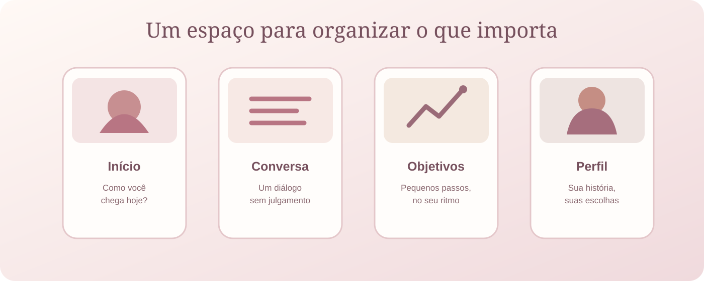
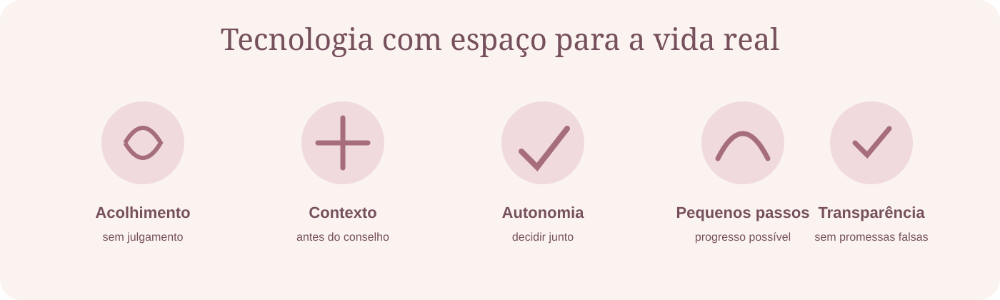
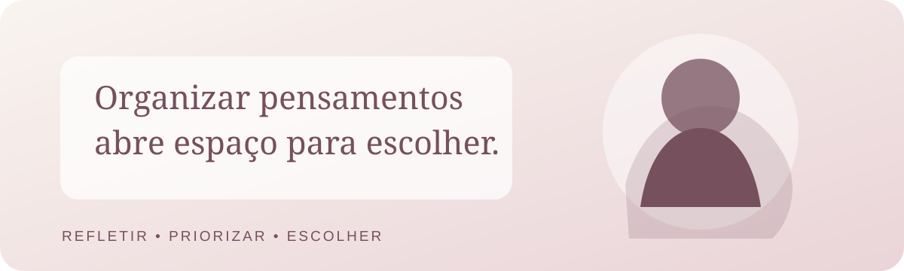

  

<h1 align="center">NORTE</h1>

  <strong>Seu tempo. Sua história. Seu caminho.</strong> 
  <em>Uma tecnologia que começa escutando.</em>

  O NORTE é uma plataforma de orientação pessoal em desenvolvimento. Sua proposta é ajudar pessoas a compreender o momento que vivem, organizar prioridades e construir próximos passos que respeitem sua realidade.

  
  
  
  
  
  

---

## A ideia por trás do NORTE

Nem sempre uma pessoa precisa de mais uma lista de tarefas, de uma cobrança ou de um conselho pronto.

Às vezes, ela precisa parar por um instante, entender o que está acontecendo e enxergar uma possibilidade de cada vez. Pode estar enfrentando uma mudança de carreira, responsabilidades acumuladas, insegurança, cansaço ou simplesmente a sensação de ter perdido a direção.

O NORTE nasce de uma convicção: **nenhum planejamento deveria ignorar a pessoa que terá de vivê-lo.**

Queremos construir uma experiência que escute antes de orientar, considere o contexto antes de sugerir e ajude a transformar intenção em passos possíveis — sem julgamentos, fórmulas mágicas ou promessas irreais.

  

> **A vida não acontece em uma planilha perfeita. A tecnologia precisa aprender a respeitar isso.**

## Como queremos que a experiência funcione

O NORTE está sendo pensado como um processo de orientação contínua, não como um gerador automático de metas.

1. **Acolher:** entender como a pessoa chega, sem julgamento.
2. **Escutar:** conhecer sua história, seu contexto, suas responsabilidades e seus limites.
3. **Organizar:** ajudar a separar preocupações, prioridades e possibilidades.
4. **Orientar:** construir próximos passos claros e realistas, com participação da própria pessoa.
5. **Adaptar:** rever o caminho quando a vida mudar — porque ela vai mudar.

  

<em>Conceito visual da experiência mobile. As telas não representam funcionalidades concluídas.</em>

### Princípios de produto

- **Humanidade antes da produtividade:** a pessoa não é uma máquina de cumprir metas.
- **Contexto antes de conselho:** recomendações precisam considerar a realidade apresentada.
- **Autonomia:** a pessoa participa das decisões e pode corrigir o que o sistema entendeu.
- **Pequenos passos:** progresso sustentável vale mais do que planos grandiosos e impraticáveis.
- **Transparência:** deixar claro o que é funcional, o que é protótipo e o que ainda é visão.
- **Privacidade desde a concepção:** dados pessoais exigem cuidado, finalidade clara e controle.

## O problema que queremos enfrentar

Muitas ferramentas ajudam a registrar tarefas. Outras oferecem conteúdos motivacionais ou planos padronizados. Mas existe um espaço importante entre saber que algo precisa mudar e conseguir descobrir por onde começar.

O NORTE pretende trabalhar nesse espaço:

- quando tudo parece urgente e falta clareza sobre prioridades;
- quando um objetivo é importante, mas parece grande demais;
- quando a rotina real não combina com o planejamento ideal;
- quando uma interrupção vira culpa e faz a pessoa abandonar o caminho;
- quando orientações genéricas não consideram as circunstâncias individuais.

O produto não promete resolver a vida de ninguém e não substitui psicólogos, médicos, consultores financeiros ou outros profissionais. Sua proposta é apoiar reflexão, organização e tomada de decisão cotidiana.

## Identidade visual — Rose Edition

A Rose Edition é a direção visual escolhida para o NORTE: delicada, adulta, acolhedora e sofisticada. A intenção é transmitir proximidade e tranquilidade sem infantilizar a interface ou restringir o produto a um único público.

| Cor | Código | Aplicação |
|---|---|---|
| Rose | \`#B87583\` | Identidade e destaques |
| Blush | \`#F3DDDF\` | Superfícies e realces suaves |
| Creme | \`#F9F4EF\` | Fundo principal |
| Nude | \`#E9DCD3\` | Cartões e áreas de apoio |
| Vinho suave | \`#76505D\` | Textos e contraste |
| Champagne | \`#D7C4B8\` | Bordas e detalhes |
| Verde suave | \`#638875\` | Estados positivos |
| Âmbar | \`#C18B52\` | Atenção e alertas |

**Direção de interface:** tipografia planejada com Fraunces em títulos e DM Sans na leitura; cartões com cantos suaves; espaços generosos; ícones consistentes; movimento discreto; acessibilidade e legibilidade acima de efeitos decorativos.

  

## Visão de produto e escopo

A visão de longo prazo inclui conversa contextual, organização de objetivos, planos adaptáveis, acompanhamento de progresso e lembretes. A construção será incremental: primeiro uma base segura e validável; depois, recursos que comprovem utilidade real.

### Recorte inicial do MVP

- Cadastro, autenticação e gestão da conta.
- Conversa com IA por texto.
- Síntese do contexto compreendido, sujeita à confirmação da pessoa.
- Perfil progressivo e memória básica sob controle do usuário.
- Objetivos, plano de 7 dias, tarefas e lembretes.
- Revisão do progresso e adaptação do plano.
- Limites de uso e controle de custos da IA.

O primeiro piloto está sendo recortado para pessoas no Brasil que desejam entrar ou migrar para a área de tecnologia. Esse foco serve para validar a experiência com um público definido; não limita a visão futura do produto.

### Fora do MVP inicial

Voz, aplicativo web independente em Next.js, pagamentos, gestão financeira, comunidade, gamificação e integrações externas ficam para etapas posteriores.

  

---

## Estado real do desenvolvimento

O NORTE já possui uma fundação de backend e um protótipo Flutter navegável. **Ainda não é um produto pronto para uso público ou para armazenar dados reais.**

### Backend — fundação implementada

- API REST com Java 21 e Spring Boot 3.5.7.
- Cadastro e login com autenticação baseada em JWT.
- Consulta do perfil associado ao token autenticado.
- Persistência com Spring Data JPA e PostgreSQL 16.
- Migrações de banco com Flyway.
- Validação de dados e testes automatizados.
- Status da aplicação e health check com Spring Boot Actuator.

### Aplicativo Flutter — protótipo navegável

- Fluxos demonstrativos de entrada e criação de conta.
- Visão inicial com check-in de estado e foco atual.
- Conversa com envio local de mensagens, ainda sem IA conectada.
- Objetivos e tarefas demonstrativos, com marcação local.
- Área de perfil com opções ilustrativas de privacidade e gestão de dados.
- Primeira aplicação da identidade Rose Edition.

### O que ainda falta

1. Refinar estrutura, acessibilidade e responsividade do Flutter.
2. Evoluir autenticação com refresh token, logout e proteção contra tentativas excessivas.
3. Implementar perfil progressivo, objetivos e tarefas persistidos na API.
4. Criar o AI Gateway e a conversa orientada, com limites de custo.
5. Integrar o aplicativo Flutter à API, incluindo sessão, erros e estados de carregamento.
6. Implementar controles de privacidade e gestão de dados.
7. Ampliar testes de integração, autorização e isolamento antes de qualquer piloto.

A interface atual não consome a API; mensagens, objetivos e tarefas do protótipo são demonstrativos e locais. Consulte [docs/MVP-ESCOPO.md](docs/MVP-ESCOPO.md) para o recorte funcional e a ordem planejada de construção.

## Tecnologias

| Tecnologia | Responsabilidade |
|---|---|
| Java 21 | Linguagem do backend |
| Spring Boot 3.5.7 | Aplicação e API REST |
| Spring Security | Segurança e autenticação |
| JWT | Autenticação stateless |
| Spring Data JPA | Persistência e acesso a dados |
| PostgreSQL 16 | Banco de dados relacional |
| Flyway | Versionamento do banco |
| Maven | Dependências e build |
| Docker Compose | Ambiente local do PostgreSQL |
| Spring Boot Actuator | Monitoramento e health check |
| Flutter | Aplicativo cliente |

**Arquitetura atual:** monólito modular no backend. A prioridade é manter uma base compreensível, testável e segura, evitando complexidade prematura.

## Estrutura do repositório

\`\`\`text
norte/
├── backend/             # API Java + Spring Boot
├── frontend/            # Aplicativo Flutter (protótipo)
├── docs/                # Escopo, decisões e conceitos visuais
├── docker-compose.yml   # PostgreSQL para desenvolvimento local
└── README.md
\`\`\`

## Executar localmente

### Pré-requisitos

- JDK 21 ou superior.
- Maven 3.9 ou superior.
- Docker Desktop com WSL2 no Windows (ou Docker Engine em Linux/macOS).
- Flutter SDK para executar o cliente.

### 1. Iniciar o banco de dados

Na raiz do projeto:

\`\`\`bash
docker compose up -d
\`\`\`

O PostgreSQL ficará disponível em \`localhost:5433\`.

> As credenciais do Docker Compose são exclusivas para desenvolvimento local. Não as utilize em produção.

### 2. Executar os testes do backend

\`\`\`bash
cd backend
mvn test
\`\`\`

### 3. Iniciar a API

Ainda na pasta \`backend\`:

\`\`\`bash
mvn spring-boot:run
\`\`\`

A API ficará disponível em \`http://localhost:8080\`.

### 4. Executar o protótipo Flutter

Em outro terminal:

\`\`\`bash
cd frontend
flutter pub get
flutter run -d chrome
\`\`\`

O comando executa a versão Web do protótipo. A interface ainda não consome a API.

### 5. Verificar a API

| Método | Endpoint | Finalidade |
|---|---|---|
| GET | \`/api/v1/status\` | Status da aplicação |
| GET | \`/actuator/health\` | Health check |

## Endpoints implementados

| Método | Rota | Acesso | Finalidade |
|---|---|---|---|
| POST | \`/api/v1/auth/registro\` | Público | Criar uma conta |
| POST | \`/api/v1/auth/login\` | Público | Autenticar e obter access token |
| GET | \`/api/v1/me\` | Autenticado | Consultar o perfil do usuário autenticado |
| GET | \`/api/v1/status\` | Conforme configuração | Verificar o status da aplicação |
| GET | \`/actuator/health\` | Conforme configuração | Verificar a saúde da aplicação |

### Exemplo de autenticação com PowerShell

Com a API em execução:

\`\`\`powershell
$u = "http://localhost:8080/api/v1"

$cred = @{
    email = "ana@exemplo.com"
    senha = "senha-ficticia-123"
    nomeExibicao = "Ana"
} | ConvertTo-Json

# Cadastro
Invoke-RestMethod -Method Post -Uri "$u/auth/registro" -ContentType "application/json" -Body $cred

# Login
$t = Invoke-RestMethod -Method Post -Uri "$u/auth/login" -ContentType "application/json" -Body $cred

# Consulta do perfil autenticado
Invoke-RestMethod -Uri "$u/me" -Headers @{
    Authorization = "Bearer $($t.accessToken)"
}
\`\`\`

Use apenas dados fictícios ao testar localmente.

## Segurança, privacidade e limites atuais

Segurança e privacidade são requisitos de projeto, não itens cosméticos.

- Senhas são armazenadas com hash BCrypt, nunca em texto puro.
- A autenticação utiliza JWT no cabeçalho \`Authorization: Bearer <token>\`.
- O endpoint de perfil identifica o usuário pelo token autenticado, não por um identificador informado na URL.
- O segredo JWT é configurado por variável de ambiente (\`NORTE_JWT_SECRET\`).
- O segredo padrão é destinado somente ao desenvolvimento; com o perfil \`prod\`, a aplicação deve rejeitar esse valor padrão.
- O escopo prevê consentimento claro para uso de IA, exportação e exclusão de conta e não utilização de dados pessoais para treinamento de modelos.

  

### Limitações conhecidas

O projeto ainda não está pronto para uso com dados reais. Permanecem pendentes, entre outros itens, refresh token, revogação de sessão no logout, rate limiting, recuperação de senha, integração segura entre Flutter e API e testes de integração com banco real. Os controles de privacidade previstos também precisam ser implementados e validados antes de um piloto.

## Documentação

- [Escopo do MVP](docs/MVP-ESCOPO.md)
- [Conceito visual — experiência mobile Rose Edition](docs/norte-experiencia-rose-v2.svg)
- [Momento humano](docs/norte-momento-humano-v2.svg)
- [Escuta e acolhimento](docs/norte-principios-rose.svg)
- [Clareza e prioridades](docs/norte-clareza.svg)
- [Passos adaptáveis](docs/norte-passos.svg)
- [Privacidade](docs/norte-privacidade-rose-v2.svg)

## Contribuição

O NORTE está em desenvolvimento ativo. Sugestões, críticas técnicas e ideias são bem-vindas. Para mudanças maiores, abra uma issue antes de iniciar uma implementação, para que escopo e direção possam ser alinhados.

## Autor

**Hernandes Zion**  
GitHub: [@HernandesWolf](https://github.com/HernandesWolf)

---

  <strong>NORTE — Seu tempo. Sua história. Seu caminho.</strong> 
  <em>Um passo possível já é um começo.</em>

