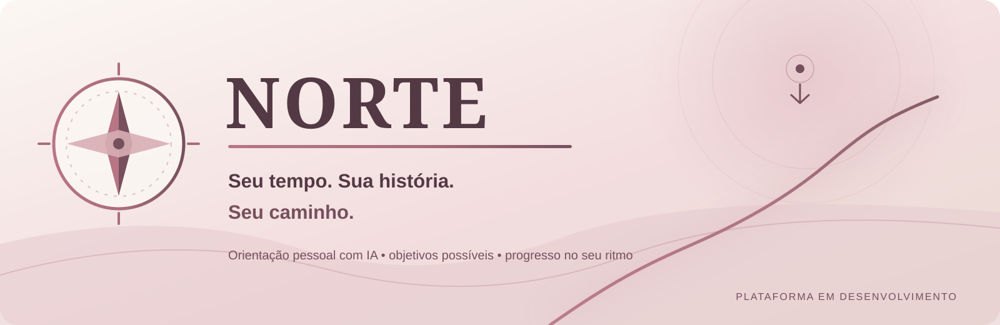

  

# NORTE

  <strong>Seu tempo. Sua história. Seu caminho.</strong>

  Uma plataforma de orientação pessoal com inteligência artificial, pensada para ajudar pessoas a compreender sua situação atual, reconhecer possibilidades e transformar objetivos em próximos passos possíveis — respeitando sua realidade, energia e circunstâncias.

  
  
  
  
  

## Sobre o projeto

Nem sempre falta capacidade ou vontade para mudar. Muitas vezes, falta clareza sobre por onde começar, energia para dar o primeiro passo ou um caminho que respeite a realidade de cada pessoa.

O **NORTE** nasce com essa proposta: ser uma plataforma de orientação pessoal que ajude o usuário a sair da sensação de estar perdido e avançar com mais clareza, contexto e ações realistas.

A experiência planejada combina conversa orientada por IA, compreensão progressiva do contexto do usuário, definição de objetivos e planos de ação adaptáveis. A tecnologia deve apoiar a pessoa — não tratá-la como uma máquina de produtividade.

> **Princípio do produto:** antes de indicar um caminho, é preciso entender a pessoa, o momento que ela vive e os recursos de que dispõe.

## O problema que queremos resolver

- **Falta de direção:** objetivos importantes parecem grandes ou difíceis demais para começar.
- **Sobrecarga:** responsabilidades e imprevistos dificultam transformar intenção em ação.
- **Orientação genérica:** conselhos que ignoram contexto, limitações e prioridades reais tendem a não funcionar.
- **Descontinuidade:** planos rígidos não acompanham mudanças de energia, rotina e circunstâncias.

O NORTE pretende transformar esse cenário em um processo progressivo: compreender, organizar, escolher uma prioridade, agir e revisar o caminho.

## Identidade visual e experiência

A direção visual oficial do projeto é a **Rose Edition**: uma identidade delicada, acolhedora e sofisticada, construída para transmitir cuidado, tranquilidade e confiança sem infantilizar a experiência.

A linguagem visual combina rose queimado, blush, nude, creme e vinho suave. O objetivo não é decorar uma ferramenta de produtividade, mas criar um ambiente digital confortável para pessoas que podem chegar cansadas, sobrecarregadas ou sem saber por onde começar.

### Conceito da marca

**Seu tempo. Sua história. Seu caminho.**

A experiência deve comunicar quatro princípios:

- **Acolhimento:** a pessoa pode começar de onde está, sem julgamento.
- **Delicadeza:** hierarquia visual leve, espaços generosos e detalhes discretos.
- **Direção:** orientação clara, sem impor um ritmo ou uma fórmula única.
- **Esperança realista:** reconhecer possibilidades sem prometer resultados mágicos.

### Paleta de cores

| Cor | Código | Aplicação prevista |
|---|---|---|
| Rose | `#B87583` | Cor de identidade e elementos de destaque |
| Blush | `#F3DDDF` | Superfícies suaves e realces |
| Creme | `#F9F4EF` | Fundo principal |
| Nude | `#E9DCD3` | Cartões e áreas de apoio |
| Vinho suave | `#76505D` | Textos de destaque e elementos de contraste |
| Champagne | `#D7C4B8` | Bordas e detalhes |
| Verde suave | `#638875` | Estados positivos |
| Âmbar | `#C18B52` | Alertas e atenção |

As combinações finais de texto e fundo deverão respeitar contraste e acessibilidade. O rose é uma cor de identidade; elementos interativos poderão usar tons mais escuros quando necessário para garantir legibilidade.

### Tipografia e componentes

- **Fraunces:** títulos e chamadas pontuais, com personalidade editorial.
- **DM Sans:** textos, formulários, navegação e conteúdo de leitura.
- **Formas:** cartões com cantos suaves, espaços generosos e organização visual simples.
- **Ícones:** traços leves e consistentes.
- **Movimento:** animações discretas, sem efeitos que distraiam ou dificultem o uso.

### Princípios de experiência

- Uma tela não deve despejar uma lista de obrigações sobre a pessoa.
- Planos e tarefas devem considerar energia, tempo e responsabilidades.
- Mensagens devem ser humanas, respeitosas e honestas, sem culpa ou pressão.
- Acolhimento não significa infantilização nem concordância automática: a IA deve reconhecer limites e comunicar incertezas.
- A interface deve ser responsiva, acessível e confortável em sessões curtas.

> A Rose Edition já possui uma primeira implementação navegável no cliente Flutter. A interface ainda é um protótipo: não está conectada à API, não autentica usuários e não deve ser usada com dados reais.

## Visão de produto

A experiência completa está sendo construída em etapas. A visão do produto inclui:

1. **Compreensão:** conversa para conhecer o contexto, os desafios e as prioridades do usuário.
2. **Clareza:** síntese do cenário e identificação de possibilidades, sempre sujeita à confirmação da pessoa.
3. **Direção:** definição de objetivos e próximos passos compatíveis com a realidade apresentada.
4. **Ação:** plano curto, tarefas e lembretes para facilitar o começo.
5. **Adaptação:** revisão do progresso e ajuste do plano quando a vida não acontece como previsto.

Esses itens representam a direção do produto; não significam que todas as funcionalidades já estejam implementadas.

## Escopo do MVP

O primeiro produto validável está concentrado em:

- Cadastro, autenticação e gestão da conta.
- Conversa com IA por texto.
- Resumo do contexto, confirmável pelo usuário.
- Perfil progressivo e memória básica sob controle do usuário.
- Objetivos, plano de 7 dias, tarefas e lembretes.
- Revisão do progresso e adaptação do plano.
- Limites de uso e controle de custos da IA.

O piloto terá como público inicial pessoas no Brasil que desejam entrar ou migrar para a área de tecnologia. Essa escolha reduz o escopo de validação sem limitar a visão futura do produto.

### Fora do MVP inicial

Voz, aplicativo web em Next.js, pagamentos, gestão financeira, comunidade, gamificação e integrações externas ficam para etapas posteriores.

---

## Estado atual do desenvolvimento

<strong>Fase 1 — Fundação técnica</strong>

O repositório contém a fundação do backend e a primeira versão navegável do cliente Flutter. A integração entre as duas partes ainda está pendente.

**Já disponível no backend:**

- API REST com Spring Boot.
- Endpoint de status da aplicação.
- Health check com Spring Boot Actuator.
- Cadastro e login com autenticação baseada em JWT.
- Consulta do perfil associado ao token autenticado.
- Persistência com Spring Data JPA, PostgreSQL e Flyway.
- Validação de dados e testes automatizados de backend.

**Cliente Flutter — protótipo inicial disponível:**

- Tela de entrada e criação de conta demonstrativas.
- Visão inicial com check-in de estado e foco atual.
- Tela de conversa com envio local de mensagens (sem IA conectada).
- Objetivos e tarefas de demonstração com marcação de conclusão.
- Área de perfil com atalhos ilustrativos de privacidade e gestão de dados.
- Identidade Rose Edition aplicada à interface.

**Próximas entregas planejadas:**

1. Validar o protótipo no Flutter SDK e refinar acessibilidade e responsividade.
2. Evoluir autenticação do backend com refresh token, logout e proteção contra tentativas excessivas.
3. Implementar perfil progressivo, objetivos e tarefas na API.
4. Criar o AI Gateway, conversa orientada e plano de ação com limites de custo.
5. Integrar o aplicativo à API com tratamento seguro de sessão, erros e estados de carregamento.
6. Executar testes de autorização, isolamento e privacidade antes de qualquer piloto.

Consulte [docs/MVP-ESCOPO.md](docs/MVP-ESCOPO.md) para ver o recorte funcional e a ordem de construção.

## Tecnologias

| Tecnologia | Papel no projeto |
|---|---|
| Java 21 | Linguagem do backend |
| Spring Boot 3.5.7 | Estrutura da aplicação e API REST |
| Spring Security | Segurança e autenticação |
| JWT | Autenticação stateless |
| Spring Data JPA | Persistência e acesso a dados |
| PostgreSQL 16 | Banco de dados relacional |
| Flyway | Versionamento e migração do banco |
| Maven | Gerenciamento de dependências e build |
| Docker Compose | Ambiente local do PostgreSQL |
| Spring Boot Actuator | Monitoramento e health check |
| Flutter | Aplicativo cliente; protótipo inicial em desenvolvimento |

**Arquitetura atual:** monólito modular no backend, organizado para permitir evolução incremental sem antecipar complexidade desnecessária.

## Estrutura do repositório

    norte/
    ├── backend/             # API Java + Spring Boot\n    ├── frontend/            # Aplicativo Flutter (protótipo Rose Edition)
    ├── docs/                # Escopo, decisões e documentação
    ├── docker-compose.yml   # PostgreSQL para desenvolvimento local
    └── README.md

## Como executar localmente

### Pré-requisitos

- JDK 21 ou superior.
- Maven 3.9 ou superior.
- Docker Desktop com WSL2 no Windows (ou Docker Engine em Linux/macOS).

### 1. Inicie o banco de dados

Na raiz do projeto:

    docker compose up -d

O PostgreSQL ficará disponível em localhost:5433.

> As credenciais definidas no Docker Compose são exclusivas para desenvolvimento local. Não as utilize em produção.

### 2. Execute os testes

    cd backend
    mvn test

### 3. Inicie a API

    mvn spring-boot:run

A API ficará disponível em http://localhost:8080.

### 4. Verifique a aplicação

| Método | Endpoint | Resultado esperado |
|---|---|---|
| GET | /api/v1/status | Status da aplicação NORTE |
| GET | /actuator/health | `{"status":"UP"}` |

## Endpoints disponíveis

| Método | Rota | Acesso | Finalidade |
|---|---|---|---|
| POST | /api/v1/auth/registro | Público | Criar uma conta |
| POST | /api/v1/auth/login | Público | Autenticar e obter access token |
| GET | /api/v1/me | Autenticado | Consultar o perfil do usuário autenticado |
| GET | /api/v1/status | Conforme configuração da API | Verificar o status da aplicação |
| GET | /actuator/health | Conforme configuração do Actuator | Verificar a saúde da aplicação |

### Exemplo de autenticação com PowerShell

Com a API em execução:

    $u = "http://localhost:8080/api/v1"

    $cred = @{
        email = "ana@exemplo.com"
        senha = "senhaforte123"
        nomeExibicao = "Ana"
    } | ConvertTo-Json

    # Cadastro
    Invoke-RestMethod -Method Post -Uri "$u/auth/registro" -ContentType "application/json" -Body $cred

    # Login
    $t = Invoke-RestMethod -Method Post -Uri "$u/auth/login" -ContentType "application/json" -Body $cred

    # Consulta do perfil autenticado
    Invoke-RestMethod -Uri "$u/me" -Headers @{
        Authorization = "Bearer $($t.accessToken)"
    }

## Segurança e privacidade

Segurança e privacidade fazem parte dos requisitos desde a fundação do projeto.

- Senhas são armazenadas com hash BCrypt; nunca em texto puro.
- A autenticação utiliza JWT no cabeçalho Authorization: Bearer <token>.
- O endpoint de perfil identifica o usuário pelo token autenticado, não por um identificador informado na URL.
- O segredo JWT é configurado por variável de ambiente (NORTE_JWT_SECRET).
- O segredo padrão é destinado somente ao ambiente de desenvolvimento; com o perfil prod, a aplicação não deve iniciar usando esse valor padrão.
- O escopo do MVP prevê consentimento claro para uso de IA, exportação e exclusão de conta e não utilização dos dados pessoais para treinamento de modelos.

### Limitações conhecidas

O projeto ainda está em desenvolvimento. Entre os itens pendentes estão refresh token, revogação de sessão no logout, rate limiting, recuperação de senha e testes de integração com banco real. Esses pontos devem ser tratados antes de uma disponibilização pública adequada.

## Documentação

- [Escopo fechado do MVP](docs/MVP-ESCOPO.md)

## Contribuição

O NORTE está em desenvolvimento ativo. Sugestões, críticas técnicas e ideias são bem-vindas. Para mudanças maiores, abra uma issue antes de iniciar uma implementação, para que o escopo e a direção do projeto possam ser alinhados.

## Autor

**Hernandes Zion**  
GitHub: [@HernandesWolf](https://github.com/HernandesWolf)

---

  <strong>NORTE — Seu tempo. Sua história. Seu caminho.</strong>

